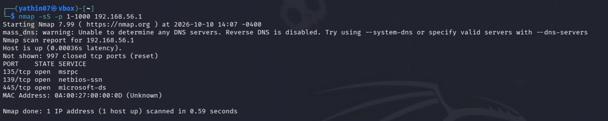
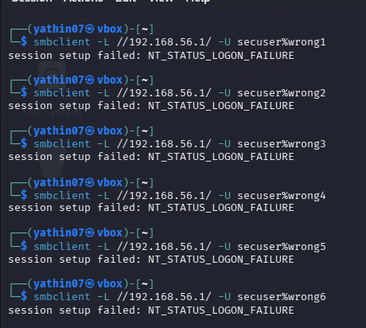
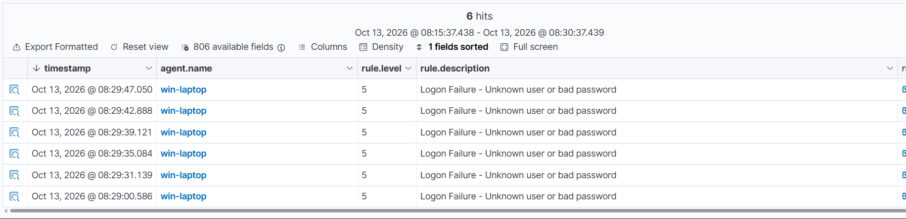

# Home SOC / SIEM Lab — Brute-Force Detection & Investigation

Built a home SOC environment from scratch to simulate a real attack lifecycle — reconnaissance, 
exploitation, detection, and incident response — using the same tools and workflow a SOC L1 
analyst uses day to day.

## Why I Built This
Most resumes list SIEM tools as skills. I wanted proof. This lab isn't a tutorial walkthrough — 
it includes a real detection bug I hit, diagnosed from raw alert data, and fixed, which is closer 
to what actual SOC work looks like than a clean first-try demo.

## Environment
| Component | Role |
|---|---|
| Windows 10/11 + Sysmon | Monitored endpoint |
| Wazuh (SIEM/XDR) | Agent-based monitoring, correlation, alerting |
| Splunk Enterprise | Log search & detection engineering |
| Kali Linux | Attacker machine |
| VirtualBox (host-only network) | Isolated lab network |

## Attack Chain

**1. Reconnaissance — Nmap**
Scanned the endpoint, found SMB-related ports open (135, 139, 445) — the attack surface used next.

**2. Exploitation — Brute Force (MITRE ATT&CK T1110)**
Ran repeated SMB login attempts via `smbclient` against a local Windows account. Confirmed in 
both SIEMs: 5 failed logins (Event ID 4625) → 1 successful login (Event ID 4624), same source IP, 
within a 2-minute window.

**3. Detection Engineering**
Wrote a custom Wazuh correlation rule to flag this pattern automatically. It didn't fire on first test. 
Instead of guessing, I pulled the raw Wazuh alert JSON and found the real cause: the rule checked 
the generic `srcip` field, but Windows events store the source IP under a nested field 
(`data.win.eventdata.ipAddress`). Fixed by switching to `<same_field>`.

Independently built a Splunk correlation search (SPL) as a second detection method — confirmed 
**3 separate brute-force windows, 6 failed attempts each**, across the attack timeframe.

**4. Investigation & Reporting**
Full incident report with timeline, root cause, IOCs, and ATT&CK mapping: 
[**Incident_Report_BruteForce_T1110.pdf**](Incident_Report_BruteForce_T1110.pdf)

## Key Findings
- Attacker IP: `192.168.56.102`
- Targeted account: `secuser` over SMB (port 445)
- Detection confirmed in two independent platforms (Wazuh + Splunk)
- Root-caused and fixed a real detection rule failure using raw log analysis, not trial and error

## Skills Demonstrated
`SIEM Engineering` `Splunk SPL` `Wazuh Rule Writing` `Sysmon` `Log Analysis` 
`MITRE ATT&CK Mapping` `Incident Response` `Root Cause Analysis`

---
*Lab built and documented by Yathin Reddy T — [LinkedIn](https://linkedin.com/in/yathin-reddy-t-082770279)*
